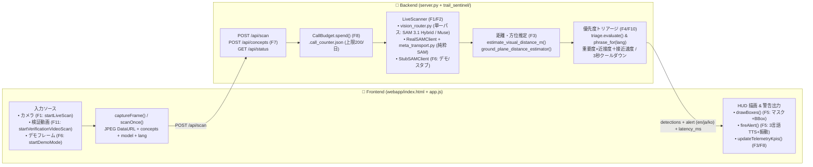

# FEATURE_MAP.md — Trail Sentinel 機能マップ & AI改修逆引きインデックス

> **AIエージェント向け最速ナビゲーション**:
> コードベース内の全主要セクションには `[FEAT:F1]` 〜 `[FEAT:F12]` のアンカーコメントが付与されています。
> 特定機能の実装箇所を1秒で特定するには以下のコマンドを実行してください：
> ```bash
> rg -n "\[FEAT:" .
> rg -n "\[FEAT:F7\]" .
> ```

---

## 1. 「どこを直せば良いか？」目的別・改修逆引きレシピ (Where to Edit)

| やりたいこと・修正したい現象 | 編集対象ファイル & シンボル（関数・定数・DOM ID） | 備考・連動箇所 |
| :--- | :--- | :--- |
| **初期の危険コンセプト（6種）や英語プロンプト・重要度(`severity`)を変えたい** | 1. [`trail_sentinel/config.py`](./trail_sentinel/config.py) (`DEFAULT_HAZARDS`)<br>2. [`webapp/app.js`](./webapp/app.js) (`HAZARD_LABELS_FALLBACK`) | `zone` は `"feet"`（足元）または `"front"`（前方）、`severity` は `1`〜`3`。 |
| **UIのテキスト・多言語翻訳（EN / JA / KO）を直したい** | [`webapp/app.js`](./webapp/app.js) (`I18N.en`, `I18N.ja`, `I18N.ko`) + [`webapp/index.html`](./webapp/index.html) (`data-i18n="..."` 属性) | 言語切替ロジックは `applyLanguage()`。 |
| **音声警告（TTS）の読み上げ文言（「前方2メートル、ヘビ」等）を変えたい** | [`trail_sentinel/triage.py`](./trail_sentinel/triage.py) (`phrase_for(det, lang)`) | 即時捕捉バナー（警告閾値未満の検知表示）は `webapp/app.js` の `formatImmediateBannerText()`。 |
| **警告が鳴る距離閾値・優先度スコア計算・クールダウン間隔を調整したい** | 1. [`trail_sentinel/triage.py`](./trail_sentinel/triage.py) (`ALERT_DISTANCE_M`, `COOLDOWN_FRAMES`, `score()`, `evaluate()`)<br>2. [`server.py`](./server.py) (`LIVE_ALERT_COOLDOWN_S`) | ブラウザ側の同一フレーズ再発話抑制（4.5秒）は `webapp/app.js` の `fireAlert()`。 |
| **AIモデルの選択肢・推論プロンプト・意味検証ロジックを変えたい** | 1. [`trail_sentinel/vision_router.py`](./trail_sentinel/vision_router.py) (`AVAILABLE_MODELS`, `_BRIDGE_CONFIG`, `scan_with_vertex_vision()`)<br>2. [`webapp/index.html`](./webapp/index.html) (`#modelSelect`) | モデルの説明文やパイプライン仕様カードの同期は `webapp/app.js` の `syncModelOptionsUI()` / `syncModelSpecUI()`。 |
| **距離推定ロジック（画面内の位置・大きさ→メートル換算）を調整したい** | 1. ライブ単一パス: [`trail_sentinel/vision_router.py`](./trail_sentinel/vision_router.py) (`estimate_visual_distance_m()`)<br>2. 純粋SAM: [`trail_sentinel/meta_transport.py`](./trail_sentinel/meta_transport.py) (`ground_plane_distance_estimator()`) | 画面下端(`bottom`)とバウンディングボックス面積(`w*h`)のハイブリッド推定。 |
| **HUDのバウンディングボックス・セグメンテーションマスク描画を変えたい** | 1. Canvas描画: [`webapp/app.js`](./webapp/app.js) (`drawBoxes()`)<br>2. マスクPNG生成: [`trail_sentinel/vision_router.py`](./trail_sentinel/vision_router.py) (`synthesize_contour_mask_png()`) | 重要度別の色（Sev3 赤 `#e5484d`, Sev2 琥珀 `#e5a93b`, Sev1 ライム `#c6f24e`）で統一。 |
| **スキャン間隔・送信画像サイズ・タイムアウト・有効期限（確認不可バッジ）を変えたい** | 1. フロント定数: [`webapp/app.js`](./webapp/app.js) (`CAPTURE_TARGET_LONG`, `NEXT_LIVE_DELAY_MS`, `SCAN_TIMEOUT_MS`, `ALERT_VALIDITY_MS`)<br>2. サーバー定数: [`server.py`](./server.py) (`LIVE_MIN_INTERVAL_S`, `LIVE_CALL_TIMEOUT_S`) | 遅延超過時の「確認不可」バッジ表示は `webapp/app.js` の `registerFailure()`。 |
| **トップ画面の「このように動きます」動画や「検証動画でスキャン」（速度切替含む）を直したい** | 1. HTML: [`webapp/index.html`](./webapp/index.html) (`#heroShowcaseVideo`, `#btnVerifyVideoHero`, `#verifySpeedSelect`)<br>2. JS: [`webapp/app.js`](./webapp/app.js) (`startVerificationVideoScan()`, `getVerificationVideoFilename()`)<br>3. 動画配置: `webapp/videos/` | 結合検証動画は `1.0x`, `0.5x`, `0.33x`, `0.25x`, `0.2x` の5段階に対応。 |
| **カスタム危険コンセプト追加（F7: テキスト＋音声入力）を直したい** | 1. バックエンド: [`trail_sentinel/config.py`](./trail_sentinel/config.py) (`_CUSTOM_HAZARD_PRESETS`, `register_custom_hazard()`) & [`server.py`](./server.py) (`add_concept()`)<br>2. フロント: [`webapp/app.js`](./webapp/app.js) (`#conceptForm`, `#btnVoiceConcept`) | 日・韓・英の主要単語はプリセットで3言語ラベルと英語プロンプトへ自動変換。 |
| **1日のAPI呼び出し上限（CallBudget）を変えたい・リセットしたい** | [`trail_sentinel/config.py`](./trail_sentinel/config.py) (`CallBudget`, 環境変数 `DAILY_CALL_CAP` デフォルト `200`) | カウンター実体は `.call_counter.json`。 |

---

## 2. 機能ID別 フルスタック対応マップ (`F1` 〜 `F12`)

| 機能ID | 機能名 | フロントエンド (`webapp/index.html`, `app.js`, `style.css`) | バックエンド (`server.py`, `trail_sentinel/*.py`) | 検証・テスト (`tests/`) |
| :---: | :--- | :--- | :--- | :--- |
| **`F1`** | **ライブカメラスキャン & フレーム送信** | `index.html`: `#cam`, `#btnStartHero`, `#btnLive`<br>`app.js`: `captureFrame()` (`#L703`), `scanOnce()` (`#L768`), `startLiveScan()` (`#L1074`) | `server.py`: `Handler._scan_live()` (`#L533`), `LiveScanner.scan()` (`#L234`), `decode_image_data_url()` (`#L192`) | `tests/test_server_live.py` (`LiveScannerTests`, `DataUrlTests`) |
| **`F2`** | **Meta AI マルチモデル & SAM 3.1 分割** | `index.html`: `#modelSelect`, `#specModelName`, `#specVerifyMode`<br>`app.js`: `syncModelOptionsUI()` (`#L474`), `syncModelSpecUI()` (`#L485`) | `vision_router.py`: `AVAILABLE_MODELS` (`#L44`), `scan_with_vertex_vision()` (`#L238`)<br>`sam_client.py`: `RealSAMClient` (`#L184`)<br>`meta_transport.py`: `MetaSAMTransport` | `tests/test_server_live.py` (`test_single_pass_vision_router_model_selection`), `tests/test_sam_client.py`, `tests/test_meta_transport.py` |
| **`F3`** | **距離・時計方向（方位）推定 & KPI表示** | `index.html`: `#kpiDistance`, `#kpiDirection`, `#kpiLatency`, `#detectionLog`<br>`app.js`: `updateTelemetryKpis()` (`#L590`), `formatBearing()` (`#L429`) | `vision_router.py`: `estimate_visual_distance_m()` (`#L187`), `clock_dir` (`#L386`)<br>`meta_transport.py`: `ground_plane_distance_estimator()` (`#L139`) | `tests/test_meta_transport.py` (`DistanceEstimatorTests`) |
| **`F4`** | **優先度トリアージ（Muse Wonder ロール）** | `app.js`: `data.alert` 受信処理 (`#L863-L876`) | `triage.py`: `ALERT_DISTANCE_M` (`#L18`), `COOLDOWN_FRAMES` (`#L19`), `approach_speed_mps()` (`#L29`), `score()` (`#L37`), `evaluate()` (`#L87`) | `main.py` (CLI 0..60フレーム実行), `tests/test_server_live.py` |
| **`F5`** | **音声警告(TTS)・振動・光学HUDオーバーレイ** | `index.html`: `#overlay`, `#alertBanner`, `#btnAudio`<br>`app.js`: `drawBoxes()` (`#L924`), `fireAlert()` (`#L1020`), `speakText()` (`#L1006`), `pickVoiceForLang()` (`#L991`) | `vision_router.py`: `synthesize_contour_mask_png()` (`#L213`)<br>`triage.py`: `phrase_for()` (`#L46`)<br>`alerts.py`: CLI用 `emit()` | ブラウザ実機 / Headless Chrome (`chrome-cli`) で `#alertBanner` と Canvas 描画を確認 |
| **`F6`** | **ヒーローデモ再生 & 誠実性（Honesty）バッジ** | `index.html`: `#btnDemoHero`, `#btnDemo`, `#demoBadge`, `#unknownBadge`<br>`app.js`: `startDemoMode()` (`#L1121`), `registerFailure()` (`#L716`) | `server.py`: `scan_frame()` (`#L142`)<br>`sam_client.py`: `StubSAMClient` (`#L148`)<br>`fixtures/hero_snake_leaves.json` | `curl -s -X POST http://localhost:8765/api/scan -H 'Content-Type: application/json' -d '{"frame_index":45,"mode":"demo","reset":true}'` |
| **`F7`** | **再学習なしカスタム危険概念追加（音声/テキスト）** | `index.html`: `#btnAddConcept`, `#conceptForm`, `#btnVoiceConcept`<br>`app.js`: `#conceptForm.onsubmit` (`#L1269`), `#btnVoiceConcept.onclick` (`#L1299`) | `server.py`: `add_concept()` (`#L424`, `POST /api/concepts`)<br>`config.py`: `register_custom_hazard()` (`#L76`), `_KO_PROMPT_PRESETS` (`#L51`) | `tests/test_server_live.py` (`CustomConceptTests`) |
| **`F8`** | **日次API呼び出し予算ガード (`CallBudget`)** | `index.html`: `#kpiBudget`, `#status`<br>`app.js`: `renderStatus()` (`#L572`), `stop_cap_reached` (`#L826`) | `config.py`: `CallBudget` (`#L141`), `BudgetExceeded` (`#L136`)<br>`server.py`: `_budget` (`#L84`), 事前チェック (`#L273`) | `tests/test_server_live.py` (`test_budget_preflight_refuses_without_any_call`) |
| **`F9`** | **評価ハーネス (`eval`) & 権利確認データ** | — (CLI評価スクリプト) | `eval/score.py`, `eval/clips_manifest.json`, `eval/data/SOURCES.md` | `python3 eval/score.py` |
| **`F10`** | **多言語対応 i18n (EN / JA / KO UI & 音声)** | `index.html`: `#langSelect`<br>`app.js`: `I18N` (`#L71`), `detectInitialLanguage()` (`#L347`), `applyLanguage()` (`#L495`) | `config.py`: `Hazard.label_for()` (`#L29`)<br>`triage.py`: `phrase_for(det, lang)` (`#L46`)<br>`server.py`: `_detection_payload()`, `_alert_payload()` | `curl` で `"lang": "ja"` / `"en"` / `"ko"` を渡して `text_ja` / `label_ja` を検証 |
| **`F11`** | **検証動画スキャン（速度切替付）& トップ画面プレビュー** | `index.html`: `#heroShowcaseVideo`, `#btnVerifyVideoHero`, `#verifySpeedBar`<br>`app.js`: `startVerificationVideoScan()` (`#L1145`), `applyVerificationVideoSpeed()` | `webapp/videos/hero_how_it_works.mp4`<br>`webapp/videos/hazard_verification_combined*.mp4` | トップ画面で `#btnVerifyVideoHero` クリック → `1.0x`/`0.5x`/`0.33x`/`0.25x` 切替確認 |
| **`F12`** | **スマホQR即時接続 & Cloud Run デプロイ** | `index.html`: `#btnQrModal`, `#qrPanel`, `#qrUrl`, `#inlineQrUrl`<br>`app.js`: `loadStatus()` 内の `window.location.origin` 動的バインド (`#L669`) | `Dockerfile`, `DEPLOY.md`, `deploy/start_demo.sh` | `#btnQrModal` クリックで QR ドロワー開閉・URLコピー動作を確認 |

---

## 3. エンドツーエンド データフロー図


