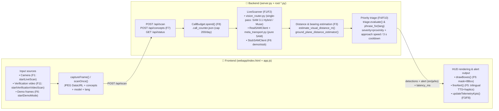

# FEATURE_MAP.md — Trail Sentinel Feature Map & AI Edit Reverse-Lookup Index

> **Fastest navigation for AI agents**:
> Every major section of the codebase carries an anchor comment from `[FEAT:F1]` to `[FEAT:F12]`.
> To pinpoint a feature's implementation in one second, run:
> ```bash
> rg -n "\[FEAT:" .
> rg -n "\[FEAT:F7\]" .
> ```

---

## 1. Goal-Based Edit Reverse-Lookup Recipes (Where to Edit)

| What you want to do / symptom to fix | Files & symbols to edit (functions, constants, DOM IDs) | Notes / linked spots |
| :--- | :--- | :--- |
| **Change the initial hazard concepts (6), English prompts, or severity levels** | 1. [`config.py`](./config.py) (`DEFAULT_HAZARDS`)<br>2. [`webapp/app.js`](./webapp/app.js) (`HAZARD_LABELS_FALLBACK`) | `zone` is `"feet"` (at your feet) or `"front"` (ahead); `severity` is `1`–`3`. |
| **Fix UI text / multilingual translations (EN / JA / KO)** | [`webapp/app.js`](./webapp/app.js) (`I18N.en`, `I18N.ja`, `I18N.ko`) + [`webapp/index.html`](./webapp/index.html) (`data-i18n="..."` attributes) | Language-switch logic is `applyLanguage()`. |
| **Change the spoken voice-alert (TTS) phrasing ("前方2メートル、ヘビ", etc.)** | [`triage.py`](./triage.py) (`phrase_for(det, lang)`) | The instant-capture banner (shows detections below the alert threshold) is `formatImmediateBannerText()` in `webapp/app.js`. |
| **Tune the alert distance threshold, priority-score computation, or cooldown interval** | 1. [`triage.py`](./triage.py) (`ALERT_DISTANCE_M`, `COOLDOWN_FRAMES`, `score()`, `evaluate()`)<br>2. [`server.py`](./server.py) (`LIVE_ALERT_COOLDOWN_S`) | Browser-side same-phrase re-speak suppression (4.5 s) is `fireAlert()` in `webapp/app.js`. |
| **Change AI model choices, inference prompts, or semantic-verification logic** | 1. [`vision_router.py`](./vision_router.py) (`AVAILABLE_MODELS`, `_BRIDGE_CONFIG`, `scan_with_vertex_vision()`)<br>2. [`webapp/index.html`](./webapp/index.html) (`#modelSelect`) | Model descriptions and pipeline spec-card sync are `syncModelOptionsUI()` / `syncModelSpecUI()` in `webapp/app.js`. |
| **Tune the distance-estimation logic (on-screen position/size → meters)** | 1. Live single-pass: [`vision_router.py`](./vision_router.py) (`estimate_visual_distance_m()`)<br>2. Pure SAM: [`meta_transport.py`](./meta_transport.py) (`ground_plane_distance_estimator()`) | Hybrid estimate from screen bottom (`bottom`) and bounding-box area (`w*h`). |
| **Change HUD bounding-box / segmentation-mask rendering** | 1. Canvas rendering: [`webapp/app.js`](./webapp/app.js) (`drawBoxes()`: SAM masks preloaded, light tint under bbox, `· SAM 3.1` pill tag)<br>2. Mask PNG generation: [`vision_router.py`](./vision_router.py) (`synthesize_contour_mask_png()`)<br>3. SAM mask guarantee: [`server.py`](./server.py) (`_detection_payload(sam_segmentation=…)`, `segmentation="sam-3.1"`, `mask_source` = `sam-mask`/`bbox-contour`) | Unified severity colors (Sev3 red `#e5484d`, Sev2 amber `#e5a93b`, Sev1 lime `#c6f24e`). SAM routes always carry a light tint mask; Muse-only routes stay bbox-only. |
| **Change scan interval, upload image size, timeout, or expiry window ("確認不可" badge)** | 1. Frontend constants: [`webapp/app.js`](./webapp/app.js) (`CAPTURE_TARGET_LONG=320`, `NEXT_LIVE_DELAY_MS=0`, `SCAN_TIMEOUT_MS`, `ALERT_VALIDITY_MS`, frame-skip `FRAME_SKIP_DIFF`/`FRAME_CACHE_MAX_MS` in `scanOnce()`)<br>2. Server constants: [`server.py`](./server.py) (`LIVE_MIN_INTERVAL_S`, `LIVE_CALL_TIMEOUT_S`)<br>3. Model fast path: [`vision_router.py`](./vision_router.py) (`_BRIDGE_CONFIG` all `MINIMAL`, `maxOutputTokens=160`, single attempt) | Performance-first: near-identical frames reuse the last result (forced re-scan ≤2 s), no artificial hold delays. The "確認不可" badge on latency overruns is `registerFailure()` in `webapp/app.js`. HUD pill is name+distance only. |
| **Fix the hero screen's "how-it-works" video ("このように動きます") or "scan with verification video" ("検証動画でスキャン", incl. speed switching)** | 1. HTML: [`webapp/index.html`](./webapp/index.html) (`#heroShowcaseVideo`, `#btnVerifyVideoHero`, `#verifySpeedSelect`)<br>2. JS: [`webapp/app.js`](./webapp/app.js) (`startVerificationVideoScan()`, `getVerificationVideoFilename()`)<br>3. Video placement: `webapp/videos/` | The combined verification video supports 5 speeds: `1.0x`, `0.5x`, `0.33x`, `0.25x`, `0.2x`. |
| **Fix custom hazard concept addition (F7: text + voice input)** | 1. Backend: [`config.py`](./config.py) (`_CUSTOM_HAZARD_PRESETS`, `register_custom_hazard()`) & [`server.py`](./server.py) (`add_concept()`)<br>2. Frontend: [`webapp/app.js`](./webapp/app.js) (`#conceptForm`, `#btnVoiceConcept`) | Major JA/KO/EN keywords auto-convert to trilingual labels and English prompts via presets. |
| **Change or reset the daily API call cap (CallBudget)** | [`config.py`](./config.py) (`CallBudget`, env var `DAILY_CALL_CAP`, default `200`) | Counter state lives in `.call_counter.json`. |

---

## 2. Full-Stack Map by Feature ID (`F1`–`F12`)

| Feature ID | Feature name | Frontend (`webapp/index.html`, `app.js`, `style.css`) | Backend (`server.py`, root `*.py`) | Verification / tests (`tests/`) |
| :---: | :--- | :--- | :--- | :--- |
| **`F1`** | **Live Camera Scan** & frame submission | `index.html`: `#cam`, `#btnStartHero`, `#btnLive`<br>`app.js`: `captureFrame()` (`#L703`), `scanOnce()` (`#L768`), `startLiveScan()` (`#L1074`) | `server.py`: `Handler._scan_live()` (`#L533`), `LiveScanner.scan()` (`#L234`), `decode_image_data_url()` (`#L192`) | `tests/test_server_live.py` (`LiveScannerTests`, `DataUrlTests`) |
| **`F2`** | **Meta AI Multi-Model Switcher & SAM 3.1 Segmentation** | `index.html`: `#modelSelect`, `#specModelName`, `#specVerifyMode`<br>`app.js`: `syncModelOptionsUI()` (`#L474`), `syncModelSpecUI()` (`#L485`) | `vision_router.py`: `AVAILABLE_MODELS` (`#L44`), `scan_with_vertex_vision()` (`#L238`)<br>`sam_client.py`: `RealSAMClient` (`#L184`)<br>`meta_transport.py`: `MetaSAMTransport` | `tests/test_server_live.py` (`test_single_pass_vision_router_model_selection`), `tests/test_sam_client.py`, `tests/test_meta_transport.py` |
| **`F3`** | **Distance & Clock-Bearing Estimation + 4-KPI Strip** | `index.html`: `#kpiDistance`, `#kpiDirection`, `#kpiLatency`, `#detectionLog`<br>`app.js`: `updateTelemetryKpis()` (`#L590`), `formatBearing()` (`#L429`) | `vision_router.py`: `estimate_visual_distance_m()` (`#L187`), `clock_dir` (`#L386`)<br>`meta_transport.py`: `ground_plane_distance_estimator()` (`#L139`) | `tests/test_meta_transport.py` (`DistanceEstimatorTests`) |
| **`F4`** | **Priority Triage (Muse Wonder Role)** | `app.js`: `data.alert` handling (`#L863-L876`) | `triage.py`: `ALERT_DISTANCE_M` (`#L18`), `COOLDOWN_FRAMES` (`#L19`), `approach_speed_mps()` (`#L29`), `score()` (`#L37`), `evaluate()` (`#L87`) | `main.py` (CLI 0..60 frame run), `tests/test_server_live.py` |
| **`F5`** | **Localized Voice Alerts (TTS), Haptics & Optical HUD** | `index.html`: `#overlay`, `#alertBanner`, `#btnAudio`<br>`app.js`: `drawBoxes()` (`#L924`), `fireAlert()` (`#L1020`), `speakAlert()` / `pickAlertAudio()` / `playAlertAudio()` (pre-generated neural voice), `preloadAlertAudio()` (idle preload of the active lang only), `speakText()` (`#L1006` fallback), `pickVoiceForLang()` (`#L991`)<br>`webapp/audio/` (126 pre-generated MP3, see `tools/make_voice.py`; served immutable) | `vision_router.py`: `synthesize_contour_mask_png()` (`#L213`)<br>`triage.py`: `phrase_for()` (`#L46`)<br>`alerts.py`: CLI `emit()`<br>`tools/make_voice.py`: neural fragment generator (edge-tts, EN/KO/JA) | Verify `#alertBanner` and canvas rendering on a real browser / headless Chrome (`chrome-cli`) |
| **`F6`** | **Hero Demo Replay & Honesty Badges** | `index.html`: `#btnDemoHero`, `#btnDemo`, `#demoBadge`, `#unknownBadge`<br>`app.js`: `startDemoMode()` (`#L1121`), `registerFailure()` (`#L716`) | `server.py`: `scan_frame()` (`#L142`)<br>`sam_client.py`: `StubSAMClient` (`#L148`)<br>`fixtures/hero_snake_leaves.json` | `curl -s -X POST http://localhost:8765/api/scan -H 'Content-Type: application/json' -d '{"frame_index":45,"mode":"demo","reset":true}'` |
| **`F7`** | **Zero-Retraining Custom Hazard Concepts** (voice/text) | `index.html`: `#btnAddConcept`, `#conceptForm`, `#btnVoiceConcept`<br>`app.js`: `#conceptForm.onsubmit` (`#L1269`), `#btnVoiceConcept.onclick` (`#L1299`) | `server.py`: `add_concept()` (`#L424`, `POST /api/concepts`)<br>`config.py`: `register_custom_hazard()` (`#L76`), `_KO_PROMPT_PRESETS` (`#L51`) | `tests/test_server_live.py` (`CustomConceptTests`) |
| **`F8`** | **Daily Call Budget Guard (CallBudget)** | `index.html`: `#kpiBudget`, `#status`<br>`app.js`: `renderStatus()` (`#L572`), `stop_cap_reached` (`#L826`) | `config.py`: `CallBudget` (`#L141`), `BudgetExceeded` (`#L136`)<br>`server.py`: `_budget` (`#L84`), preflight check (`#L273`) | `tests/test_server_live.py` (`test_budget_preflight_refuses_without_any_call`) |
| **`F9`** | **Evaluation Harness** (`eval`) **& Rights-Cleared Media** | — (CLI eval script) | `eval/score.py`, `eval/clips_manifest.json`, `eval/data/SOURCES.md` | `python3 eval/score.py` |
| **`F10`** | **Multi-Language i18n (EN/KO/JA)** (UI & voice) | `index.html`: `#langSelect`<br>`app.js`: `I18N` (`#L71`), `detectInitialLanguage()` (`#L347`), `applyLanguage()` (`#L495`) | `config.py`: `Hazard.label_for()` (`#L29`)<br>`triage.py`: `phrase_for(det, lang)` (`#L46`)<br>`server.py`: `_detection_payload()`, `_alert_payload()` | Pass `"lang": "ja"` / `"en"` / `"ko"` via `curl` and verify `text_ja` / `label_ja` |
| **`F11`** | **Verification Video Scan** (with speed switching) **& How-It-Works Showcase** | `index.html`: `#heroShowcaseVideo`, `#btnVerifyVideoHero`, `#verifySpeedBar`<br>`app.js`: `startVerificationVideoScan()` (`#L1145`), `applyVerificationVideoSpeed()` | `webapp/videos/hero_how_it_works.mp4`<br>`webapp/videos/hazard_verification_combined*.mp4` | On the hero screen, click `#btnVerifyVideoHero` → verify `1.0x`/`0.5x`/`0.33x`/`0.25x` switching |
| **`F12`** | **Instant Mobile QR Access & Cloud Run Deployment** | `index.html`: `#btnQrModal`, `#qrPanel`, `#qrUrl`, `#inlineQrUrl`<br>`app.js`: `loadStatus()` with `window.location.origin` dynamic binding (`#L669`) | `Dockerfile`, `DEPLOY.md`, `deploy/start_demo.sh` | Click `#btnQrModal` to verify QR drawer open/close and URL-copy behavior |

---

## 3. End-to-End Dataflow Diagram


