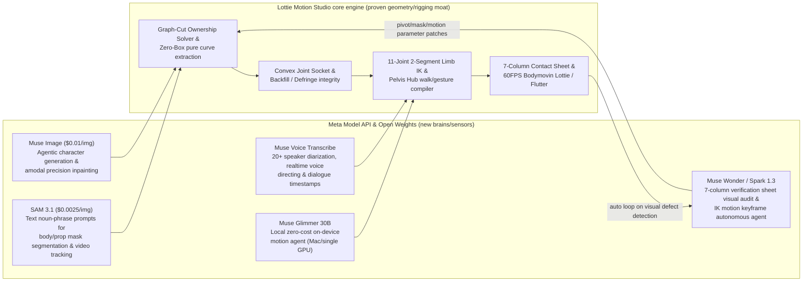

# 03. Hackathon Idea Proposals and `lottie-motion-studio` Synergy Strategy

This document precisely analyzes the technical assets in [`~/dev/buddypia/lottie-motion-studio`](file:///Users/a13973/dev/buddypia/lottie-motion-studio/README.ko.md) and proposes project ideas that combine them with the **Meta Global AI Developer Hackathon** judging criteria and the new model ecosystem (**SAM 3.1**, **Muse Image**, **Muse Spark 1.3 / Wonder**, **Muse Voice Transcribe**, **Muse Glimmer**) to compete for the win.

---

## 1. Why `lottie-motion-studio` Is an Overwhelming Weapon in This Hackathon

In both gates of the hackathon (passing the application → winning the finals), `lottie-motion-studio` provides a **deep domain-engineering moat** that ordinary participants can never replicate in just 10 days.

### 1.1 Decisive Advantage in the Application Review
- **50%** of the application evaluation is `Q9: Tell us about an AI project you recently built that showcases your technical skills`.
- `lottie-motion-studio` is not a simple LLM API wrapper; it is:
  1. **Zero-Box Organic Contour Extraction**: a 7-layer (`bg`, `legs`, `torso`, `head`, `arm_left`, `arm_right`, `prop`) decomposition pipeline that permanently bans rectangular bounding-box cropping and combines adaptive foreground matting + anatomic priors + outline-cell majority voting
  2. **Amodal Inpainting & Convex Joint Socket Math**: convex socket expansion guaranteeing 0px gaps under $\pm 45^\circ$ joint rotation ($\text{Mask}_{\text{raw}} \cup \text{Disk}(P_{\text{joint}}, R_{\text{socket}})$), PyTorch FFC / Navier-Stokes amodal inpainting, foreground bag `<layer>__backfill` dual-layer compositing, Lvmin Zhang alpha pyramid defringing
  3. **11-Joint 2-Segment Limb IK & Pelvis Hub Engine**: upper-arm/forearm and thigh/shin/ankle 2-segment splits with a pelvis-hub-based walking inverse kinematics engine (`solve_two_bone_ik`), heel-strike-to-toe-off foot roll, and spine/neck anti-phase sway correction
  4. **Zero-Decoding Semantic Motion Decision Engine**: a decision engine using `EmbeddingGemma 2` to convert natural-language prompts into motion intent (Choice) and continuous intensity/tempo scalars (Score) within 20–45ms, plus a Hillclimb evaluation harness
  5. **7-Column Verification Contact Sheet & Quality Gate**: a 1920px 7-column verification sheet with an automated 4-extreme-frame audit pipeline
- Describing this in detail in application Q9 earns the **top technical score (50%)** and passes the 20,000-applicant rolling selection immediately.

### 1.2 Current Limitations of `lottie-motion-studio` and a Perfect Puzzle Fit with Meta's New Models
As diagnosed in [`docs/oss/motion-image-part-decomposition/v8/thorough-oss-research-reassessment-2026-06-26.md`](file:///Users/a13973/dev/buddypia/lottie-motion-studio/docs/oss/motion-image-part-decomposition/v8/thorough-oss-research-reassessment-2026-06-26.md), the biggest open problem of the existing pipeline was **"how to zero-shot accurately separate each pixel's anatomical ownership in a single illustration with mixed complex scenes, and fill the occluded regions with high quality."**

Remarkably, the models Meta released for this hackathon solve this challenge head-on:

---

## 2. Top 3 Proposed Ideas Based on `lottie-motion-studio` (Track A)

### 🏆 Idea A1 (Top Recommendation): **MuseMotion Studio (Lottie Motion Studio 2.0)**
> **"A multi-agent motion studio that autonomously generates, decomposes, rigs, and verifies commercial 60FPS Lottie animations from a prompt, voice, or a single illustration"**
> - **Fitting themes**: **Build for Your World** (cuts designers'/developers' motion asset production time from hours to 10 seconds) & **Push the Frontier** (combines vision segmentation + amodal generation + geometric IK compiler + autonomous visual QA loop)
> - **Meta models used (full-stack combination of 5 models — maximizing the Tooling score of 25%)**:
>   1. **SAM 3.1 (`sam-3.1`)**: Extract text-prompt masks for `"head"`, `"torso"`, `"left arm"`, `"right arm"`, `"left leg"`, `"right leg"`, `"handheld prop"`, `"background object"` from an uploaded character image and inject them as priors into `lottie-motion-studio`'s Ownership Solver.
>   2. **Muse Image (`muse-image-1.0`)**:
>      - (Generation) When no character exists, generate rig-optimized characters and prop/expression variations (Anchored Composition) from text prompts.
>      - (Amodal restoration) When arms or bags move, restore the exposed `torso` gaps and the background plate (`bg.png`) with `Muse Image`'s Reasoning-Driven Edit — recovering costume patterns and background details perfectly instead of the previous naive blur inpainting.
>   3. **Muse Spark 1.3 / Muse Wonder (`muse-spark-1.3` / `muse-wonder-1.0`)**:
>      - **Autonomous Visual QA Loop**: `lottie-motion-studio`'s **7-Column Verification Contact Sheet (`parts_contour_verification.png`)** and extreme-pose frames (frames 8, 23, 38, 53) are read directly by `Muse Spark 1.3`'s multimodal vision, which judges joint breaks, background bleed, and floating feet itself and autonomously calls `patch_mask` / `adjust_pivot` / `resegment` tools, self-healing until defects reach zero.
>   4. **Muse Voice Transcribe (`muse-voice-transcribe-1.0`)**:
>      - Realtime voice directing (`wss://api.meta.ai/v1/asr/realtime`): when the user says into the microphone *"put a passport in the right hand and make the character walk briskly while waving cheerfully"* (original Korean: *"오른손에 여권 들고 신나게 인사하면서 총총걸음으로 걸어가게 해줘"*), motion parameters and prop bindings (`ATTACHMENTS`) are manipulated in realtime.
>   5. **Muse Glimmer 30B (local open weights)**:
>      - Runs locally alongside `EmbeddingGemma 2` in offline/local environments, synthesizing composite-scenario motion timelines (e.g., multi-phase sequences like "walk in, stop, wave, then jump") at $0 cloud API cost.

#### Why It Overwhelms the Judges (Mapping to Judging Criteria)
- **Impact (30%)**: Fully automates a task that previously required skilled After Effects artists — product teams want 60FPS Lottie JSON at ~1/50th the size of MP4 video in web/app (iOS, Android, Flutter) products.
- **Use of Meta AI Tooling (25%)**: Not just a chatbot — it weaves Meta's 5 key models into an organic pipeline: **SAM 3.1 (visual part perception) → Muse Image (amodal restoration and generation) → Muse Spark 1.3 (autonomous visual debugging loop on the 7-column verification sheet) → Muse Voice Transcribe (realtime voice directing) → Muse Glimmer (local on-device inference)**.
- **Demo (25%)**: Since `lottie-motion-studio`'s premium Electric Blue web workbench (`web/index.html`) and Flutter app (`lib/main.dart`) are already complete, the live demo — **"generate a character from a prompt on the spot → automatic part decomposition with SAM 3.1 + Muse Image → self-healing on the 7-column sheet → change motion by voice command → instant 60FPS Lottie & Flutter playback"** — delivers explosive visual impact.
- **Technical Depth (20%)**: The solid mathematical/geometric foundations — convex socket geometry, 2-segment limb IK, foreground bag backfill (`__backfill`), 7-column verification sheet — are proven by code and tests (`make q.check`).

---

### 🎬 Idea A2: **KineticLottie — A Motion Retargeting Engine That Compiles Real-World Video Motion into 20KB 60FPS 2D Lottie**
> **"Analyze a 5-second smartphone video with SAM 3.1 video tracking and Muse Spark, and convert it into an ultra-lightweight 2D character Lottie JSON"**
> - **Fitting theme**: **Push the Frontier** (a Video-to-Lottie compiler that compresses/transforms real-world physical human motion into ultra-lightweight 2D vector/layer keyframe structures)
> - **Core workflow**:
>   1. The user films their own motion (greeting, walking, dancing, presentation gestures) for 3–5 seconds with a webcam or smartphone.
>   2. **SAM 3.1 Video Tracking (`sam-3.1`, $0.20/1k frames)** is prompted with `"person's head"`, `"torso"`, `"left arm"`, `"right arm"`, `"left leg"`, `"right leg"`, `"handheld object"` to extract body-part masks and trajectories across all frames.
>   3. **Muse Spark 1.3** analyzes the extracted per-frame part-mask center axes and angle time series, denoises them, and performs inverse-kinematics (IK) fitting into `lottie-motion-studio`'s 11-joint 2-segment limb spec (`MOTION_PARAM_SCHEMA` and per-frame joint-rotation keyframe arrays).
>   4. Meanwhile, **Muse Image (`muse-image-1.0`)** references the video's first frame (Anchored Composition) to generate a clean flat-illustration character, and the `lottie-motion-studio` engine decomposes/rigs the parts and exports a **60FPS Lottie JSON faithfully reproducing the original video's motion**.
> - **Differentiator**: An innovative approach that captures real-world motion as **transparent-background, 60FPS runtime-interactive Lottie animations of tens of KB** instead of heavy generative video (MP4, tens of MB, no transparent background, no interaction).

---

### 🎙️ Idea A3: **MuseCast Live — A Studio That Converts Multi-Speaker Voice/Podcasts into an Interactive Multi-Character Lottie Theater**
> **"Feed in an audio file or realtime conversation, and automatically produce a web/mobile Lottie animation where 20+ distinguished speakers move with their dialogue and emotions"**
> - **Fitting theme**: **Build for Your World** (conversational animation content automation for creators, educators, and global language-learning apps — e.g., Daily Hangul)
> - **Core workflow**:
>   1. Stream multi-party conversation audio (or realtime microphone input) through **Muse Voice Transcribe (`muse-voice-transcribe-1.0`)** to obtain **speaker diarization (Speaker A, B, C...) and utterance timestamps**.
>   2. Generate consistent 2D character illustrations and props matching each speaker's persona via **Muse Image (`muse-image-1.0`)** Anchored Composition.
>   3. Automatically decompose parts and rig 11 joints for each character with the **SAM 3.1 + `lottie-motion-studio`** pipeline.
>   4. **Muse Spark 1.3** analyzes each utterance turn's text sentiment/context, placing `wave_greeting`, `proud_stride`, emphasis gestures, and head nods (`head_nod`) on the speaking character and natural `idle_breathing` plus reaction motions on listening characters along the timeline — compiling a **complete multi-character Lottie scene**.

---

## 3. Three More Standalone/Hybrid Frontier Ideas Beyond `lottie-motion-studio` (Track B)

If you prefer to use `lottie-motion-studio` only for application Q9 (proving technical ability) and build a completely new product in the finals, the following three directions are also very strong:

### 🔬 Idea B1 (Push the Frontier): **SAM-Lab — A Vision Engineering Agent That Auto-Measures and Simulates Physical Quantities from Science/Manufacturing Experiment Videos**
- **Background**: Directly targets the `Push the Frontier` theme text: *"accelerate a scientific experiment, or unlock a better way to understand and control a physical system."*
- **Content**: Upload a chemistry experiment (titration, crystal growth), material crack test, fluid dynamics, or robot gripper video, and **SAM 3.1 Video** tracks specimens/sensors/liquid interfaces pixel-precisely from text prompts alone, while **Muse Wonder** auto-writes and executes (Modal Sandbox integration) Python physics-analysis code computing per-frame mask area/velocity/acceleration/angle changes — fitting physics equations and generating anomaly reports.

### 🛠️ Idea B2 (Build for Your World): **MuseUI Healer — An Autonomous Frontend QA Agent That Sees and Fixes Visual UI Bugs and Broken Layouts Itself**
- **Background**: An idea extending the `design_guard.py`, `i18n_guard.py`, and canvas viewport invariant test experience built in `lottie-motion-studio` into a general-purpose web development tool.
- **Content**: Capture the local dev-server screen, precisely segment overlapping buttons, clipped text, and occluded below-viewport elements with **SAM 3.1**, then **Muse Wonder** (Computer Use + multi-file coding) traces the DOM/CSS cause, fixes it, and loops autonomously with **Muse Image** pixel-comparing against the designer's intended reference mock until it passes.

### 🗣️ Idea B3 (Build for Your World): **BabelStage — A Live Copilot That Instantly Generates Diagrams and Interactive Visuals from Realtime Multi-Speaker Meetings/Lectures**
- **Content**: While recognizing meeting/lecture speech in realtime with **Muse Voice Transcribe** ($0.18/hr, 20+ speaker diarization), every speaker turn triggers **Muse Spark 1.3** to structure the key points and project architecture diagrams, comparison tables, and visual cards onto the screen within 2 seconds via **Muse Image** ($0.01/image) and HTML canvas — a realtime visual meeting board.

---

## 4. 10-Day Execution Roadmap for the Top Recommendation (Idea A1: MuseMotion Studio 2.0)

When extending the existing `lottie-motion-studio` worktree into a hackathon project, **over 80% of the hardest core engine (Web Workbench, 11-joint IK, convex sockets, 7-column sheet, Flutter app, 3-language i18n) is already ready**, so all 10 days can focus 100% on integrating Meta AI's 5 key models and polishing the live demo!

| Date | Key Milestone | Implementation Details |
| :--- | :--- | :--- |
| **D-Day (10/24–10/25)** | **Application submitted** | Submit the Cerebral Valley application based on the draft in `docs/04-application-guide-and-draft-answers.md` (submit immediately — the 20,000-applicant cap may close early) |
| **Day 1–2 (10/26–10/27)** | **Meta Model API adapters** | Create `tool/meta_ai_client.py` (`https://api.meta.ai/v1` integration): `sam-3.1` mask extractor, `muse-image-1.0` character generation and amodal inpainting module integration |
| **Day 3–4 (10/28–10/29)** | **SAM 3.1 + Muse Image part-decomposition pipeline** | Combine SAM 3.1 text-prompt (`head`, `torso`, `left arm`, `right arm`, `left leg`, `right leg`, `prop`) mask priors into `segmenter/body_partition.py` and `pipeline.py` + integrate Muse Image-based `torso` / `bg` amodal inpainting |
| **Day 5–6 (10/30–10/31)** | **Muse Wonder / Spark 1.3 autonomous Visual QA loop** | Feed `parts_contour_verification.png` (7-column sheet) into `muse-spark-1.3` vision to auto-score joint gaps/background residue/floating feet, and implement an agent loop that autonomously corrects pivot/mask parameters when defects are found |
| **Day 7–8 (11/01–11/02)** | **Muse Voice Transcribe & video motion retargeting** | Add a realtime microphone voice-directing (`muse-voice-transcribe-1.0`) tab and a short real-video upload → SAM 3.1 video-tracking-based motion retargeting tab to the web workbench (`web/index.html`) |
| **Day 9–10 (11/03–11/04)** | **Demo video production & final submission** | Shoot a dense 2–3 minute live demo video to maximize the demo score (25%) (prompt-based character generation → SAM 3.1 segmentation → 7-column self-healing → voice directing → Flutter/Web 60FPS Lottie export) and upload to the submission portal |
