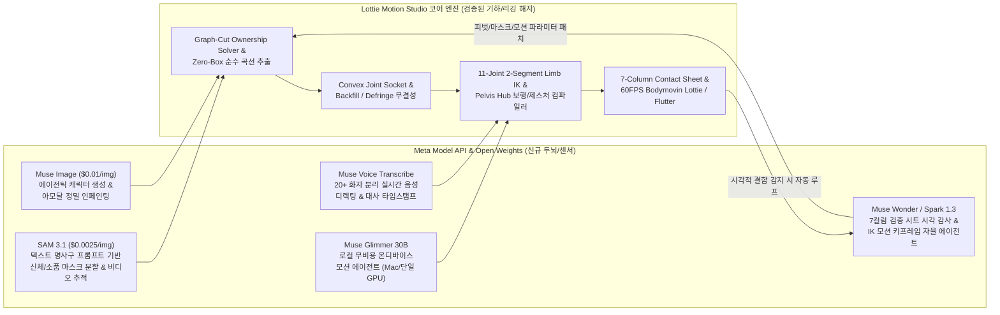

# 03. 해커톤 아이디어 제안 및 `lottie-motion-studio` 연계 전략

본 문서는 보유하고 계신 [`~/dev/buddypia/lottie-motion-studio`](file:///Users/a13973/dev/buddypia/lottie-motion-studio/README.ko.md)의 기술 자산을 정밀 분석하고, 이를 **Meta Global AI Developer Hackathon**의 심사 기준 및 신규 모델 생태계(**SAM 3.1**, **Muse Image**, **Muse Spark 1.3 / Wonder**, **Muse Voice Transcribe**, **Muse Glimmer**)와 결합하여 우승을 노릴 수 있는 프로젝트 아이디어를 제안합니다.

---

## 1. 왜 `lottie-motion-studio`가 이번 해커톤에서 압도적인 무기인가?

해커톤의 두 가지 관문(지원서 통과 → 본선 우승) 모두에서 `lottie-motion-studio`는 일반적인 해커톤 참가자들이 10일 만에 절대 따라올 수 없는 **깊은 도메인 엔지니어링 해자(Moat)**를 제공합니다.

### 1.1 지원서 심사(Application Review)에서의 결정적 우위
- 지원서 평가의 **50%**가 `Q9: Tell us about an AI project you recently built that showcases your technical skills`입니다.
- `lottie-motion-studio`는 단순 LLM API 래퍼가 아니라:
  1. **Zero-Box Organic Contour Extraction**: 사각형 바운딩 박스 절단을 영구 금지하고, 적응형 전경 마팅 + 해부학적 사전분포(Anatomic Prior) + 외곽선 셀(Outline Cells) 다수결 투표를 결합한 7레이어(`bg`, `legs`, `torso`, `head`, `arm_left`, `arm_right`, `prop`) 분해 파이프라인
  2. **Amodal Inpainting & Convex Joint Socket Math**: $\pm 45^\circ$ 관절 회전 시 0px 틈새를 보장하는 볼록 소켓 확장($\text{Mask}_{\text{raw}} \cup \text{Disk}(P_{\text{joint}}, R_{\text{socket}})$), PyTorch FFC / Navier-Stokes 아모달 인페인팅, 전경 가방 `<layer>__backfill` 이중 레이어 합성, Lvmin Zhang 알파 피라미드 디프린징
  3. **11-Joint 2-Segment Limb IK & Pelvis Hub Engine**: 상완/전완, 허벅지/종아리/발목 2단 분할 및 골반 허브(`pelvis`) 기반 보행 역기구학(`solve_two_bone_ik`), 힐스트라이크~토오프 발 구름(Foot Roll), 척추/목 역위상 흔들림 보정
  4. **Zero-Decoding Semantic Motion Decision Engine**: `EmbeddingGemma 2`를 활용해 20~45ms 내에 자연어 프롬프트를 모션 의도(Choice)와 강도/템포 연속 스칼라(Score)로 변환하는 결정 엔진 및 Hillclimb 평가 하니스
  5. **7-Column Verification Contact Sheet & Quality Gate**: 1920px 7컬럼 검증 시트와 4개 극단 프레임 자동 감사 체계
- 이 내용을 지원서 Q9에 구체적으로 서술하면 **기술력 점수(50%)에서 최고점**을 받아 20,000명 롤링 선발을 즉시 통과할 수 있습니다.

### 1.2 `lottie-motion-studio`의 현재 한계점과 Meta 신규 모델의 완벽한 퍼즐 결합
[`docs/oss/motion-image-part-decomposition/v8/thorough-oss-research-reassessment-2026-06-26.md`](file:///Users/a13973/dev/buddypia/lottie-motion-studio/docs/oss/motion-image-part-decomposition/v8/thorough-oss-research-reassessment-2026-06-26.md)에서 진단하셨듯, 기존 파이프라인의 가장 큰 고민은 **"복잡한 씬이 섞인 단일 일러스트에서 각 픽셀의 해부학적 소유권(Ownership)을 어떻게 제로샷으로 정확히 분리하고, 가려진 영역을 고품질로 채울 것인가"**였습니다.

놀랍게도 이번 해커톤에서 Meta가 공개한 모델들이 이 난제를 정확히 정면으로 해결합니다:

---

## 2. `lottie-motion-studio` 기반 핵심 제안 아이디어 3선 (Track A)

### 🏆 아이디어 A1 (최우선 추천): **MuseMotion Studio (Lottie Motion Studio 2.0)**
> **"프롬프트·음성·단일 일러스트로부터 상용 60FPS Lottie 애니메이션을 자율 생성·분해·리깅·검증하는 멀티에이전트 모션 스튜디오"**
> - **적합 테마**: **Build for Your World** (디자이너/개발자의 모션 에셋 제작 시간을 수 시간에서 10초로 단축) & **Push the Frontier** (비전 분할 + 아모달 생성 + 기하학적 IK 컴파일러 + 자율 시각 QA 루프 결합)
> - **활용 Meta 모델 (5종 풀스택 결합 — Tooling 점수 25% 극대화)**:
>   1. **SAM 3.1 (`sam-3.1`)**: 업로드된 캐릭터 이미지에 대해 `"head"`, `"torso"`, `"left arm"`, `"right arm"`, `"left leg"`, `"right leg"`, `"handheld prop"`, `"background object"` 텍스트 프롬프트 마스크를 추출하여 `lottie-motion-studio`의 Ownership Solver 사전 확률(Prior)로 주입.
>   2. **Muse Image (`muse-image-1.0`)**:
>      - (생성) 캐릭터가 없을 때 텍스트 프롬프트로 리깅 최적화된 캐릭터 및 소품/표정 바리에이션(Anchored Composition) 생성.
>      - (아모달 복원) 팔이나 가방이 움직일 때 드러나는 몸통(`torso`) 빈자리와 배경 판(`bg.png`)을 기존 단순 블러 인페인팅 대신 `Muse Image`의 Reasoning-Driven Edit으로 의상 패턴과 배경 디테일까지 완벽 복원.
>   3. **Muse Spark 1.3 / Muse Wonder (`muse-spark-1.3` / `muse-wonder-1.0`)**:
>      - **Autonomous Visual QA Loop**: `lottie-motion-studio`가 생성한 **7-Column Verification Contact Sheet (`parts_contour_verification.png`)**와 극단 포즈 프레임(8, 23, 38, 53F)을 `Muse Spark 1.3`의 멀티모달 비전으로 직접 읽어들여, 어깨 틈새(Joint Break), 배경 끌림(Background Bleed), 발 뜸(Floating Feet) 여부를 스스로 판정하고 `patch_mask` / `adjust_pivot` / `resegment` 도구를 자율 호출해 결함이 0이 될 때까지 자가 치유(Self-Healing).
>   4. **Muse Voice Transcribe (`muse-voice-transcribe-1.0`)**:
>      - 실시간 음성 디렉팅(`wss://api.meta.ai/v1/asr/realtime`): 사용자가 마이크로 *"오른손에 여권 들고 신나게 인사하면서 총총걸음으로 걸어가게 해줘"*라고 말하면 실시간으로 모션 파라미터와 소품 결속(`ATTACHMENTS`)을 조작.
>   5. **Muse Glimmer 30B (로컬 오픈웨이트)**:
>      - 오프라인/로컬 환경에서 `EmbeddingGemma 2`와 함께 구동되어 클라우드 API 비용 $0로 복합 시나리오 모션 타임라인(예: "걸어오다가 멈춰서 손 흔들고 점프하기" 같은 다중 페이즈 시퀀스)을 합성.

#### 왜 심사위원을 압도하는가? (심사 기준별 매핑)
- **Impact (30%)**: 웹/앱(iOS, Android, Flutter) 프로덕트에서 MP4 비디오 대신 용량이 1/50 수준인 60FPS Lottie JSON을 쓰고 싶어도 After Effects 숙련자가 필요했던 문제를 완전 자동화합니다.
- **Use of Meta AI Tooling (25%)**: 단순히 챗봇을 만든 것이 아니라, **SAM 3.1(시각 파츠 인지) → Muse Image(아모달 복원 및 생성) → Muse Spark 1.3(7컬럼 검증 시트 기반 자율 시각 디버깅 루프) → Muse Voice Transcribe(실시간 보이스 디렉팅) → Muse Glimmer(로컬 온디바이스 추론)**까지 Meta의 5대 모델을 유기적 파이프라인으로 엮어냅니다.
- **Demo (25%)**: 이미 `lottie-motion-studio`의 고품격 Electric Blue 웹 워크벤치(`web/index.html`)와 Flutter 앱(`lib/main.dart`)이 완성되어 있으므로, 라이브 데모에서 **"즉석에서 캐릭터 생성 → SAM 3.1 + Muse Image 자동 파츠 분해 → 7컬럼 시트 자가 수리 → 음성 명령으로 모션 변경 → 60FPS Lottie & Flutter 즉시 구동"**을 보여주면 시각적 임팩트가 폭발적입니다.
- **Technical Depth (20%)**: 볼록 소켓 기하학, 2세그먼트 사지 IK, 전경 가방 백필(`__backfill`), 7컬럼 검증 시트 등 탄탄한 수학적·기하학적 기반이 코드와 테스트(`make q.check`)로 증명되어 있습니다.

---

### 🎬 아이디어 A2: **KineticLottie — 실사 비디오 동작을 20KB 60FPS 2D Lottie로 컴파일하는 모션 리타겟팅 엔진**
> **"스마트폰으로 찍은 5초짜리 실사 영상을 SAM 3.1 비디오 추적과 Muse Spark로 분석해 초경량 2D 캐릭터 Lottie JSON으로 변환"**
> - **적합 테마**: **Push the Frontier** (실세계 물리적 인체 움직임을 초경량 2D 벡터/레이어 키프레임 구조체로 압축·변환하는 Video-to-Lottie 컴파일러)
> - **핵심 워크플로우**:
>   1. 사용자가 웹캠이나 스마트폰으로 자신의 동작(인사, 워킹, 댄스, 발표 제스처) 영상을 3~5초 촬영합니다.
>   2. **SAM 3.1 Video Tracking (`sam-3.1`, $0.20/1k frames)**에 `"person's head"`, `"torso"`, `"left arm"`, `"right arm"`, `"left leg"`, `"right leg"`, `"handheld object"` 프롬프트를 주어 모든 프레임에 걸친 신체 파츠 마스크와 궤적을 추출합니다.
>   3. **Muse Spark 1.3**이 추출된 프레임별 파츠 마스크 중심축과 각도 시계열 데이터를 분석해 노이즈를 제거하고, `lottie-motion-studio`의 11관절 2세그먼트 사지 규격(`MOTION_PARAM_SCHEMA` 및 프레임별 관절 회전 키프레임 배열)으로 역기구학(IK) 피팅을 수행합니다.
>   4. 동시에 **Muse Image (`muse-image-1.0`)**가 영상의 첫 프레임을 참조(Anchored Composition)하여 깔끔한 플랫 일러스트 캐릭터를 생성하고, `lottie-motion-studio` 엔진이 파츠를 분해·리깅하여 **원본 영상의 움직임을 그대로 재현하는 60FPS Lottie JSON**을 내보냅니다.
> - **차별점**: 무거운 생성형 비디오(MP4, 수십 MB, 투명 배경 불가, 인터랙션 불가) 대신 **투명 배경과 60FPS 런타임 인터랙션이 가능한 수십 KB짜리 Lottie 애니메이션**으로 실사 모션을 캡처하는 혁신적인 접근입니다.

---

### 🎙️ 아이디어 A3: **MuseCast Live — 다화자 음성/팟캐스트를 인터랙티브 멀티 캐릭터 Lottie 극장으로 변환하는 스튜디오**
> **"오디오 파일이나 실시간 대화를 넣으면 20명 이상의 화자를 구분해 각 캐릭터가 대사와 감정에 맞춰 움직이는 웹/모바일 Lottie 애니메이션 자동 제작"**
> - **적합 테마**: **Build for Your World** (크리에이터, 교육자, 글로벌 언어 학습 앱 — 예: Daily Hangul 등 — 을 위한 대화형 애니메이션 콘텐츠 자동화)
> - **핵심 워크플로우**:
>   1. **Muse Voice Transcribe (`muse-voice-transcribe-1.0`)**로 다자간 대화 오디오(또는 실시간 마이크 입력)를 스트리밍 전사하여 **화자 분리(Speaker A, B, C...) 및 발화 구간 타임스탬프**를 획득합니다.
>   2. **Muse Image (`muse-image-1.0`)**의 Anchored Composition으로 각 화자의 페르소나에 맞는 일관된 2D 캐릭터 일러스트와 소품을 생성합니다.
>   3. **SAM 3.1 + `lottie-motion-studio`** 파이프라인으로 각 캐릭터를 자동 파츠 분해 및 11관절 리깅합니다.
>   4. **Muse Spark 1.3**이 각 발화 턴의 텍스트 감정·맥락을 분석해 발화 중인 캐릭터에게는 `wave_greeting`, `proud_stride`, 강조 제스처 및 고개 끄덕임(`head_nod`)을, 경청 중인 캐릭터에게는 자연스러운 `idle_breathing`과 리액션 모션을 타임라인에 맞게 배치하여 **완전한 멀티 캐릭터 Lottie 씬**을 컴파일합니다.

---

## 3. `lottie-motion-studio` 외에 새롭게 도전할 수 있는 독립/하이브리드 프론티어 아이디어 3선 (Track B)

만약 `lottie-motion-studio`는 지원서 Q9(기술 역량 증명)에만 활용하고, 본선에서는 완전히 새로운 프로덕트를 만들고 싶으시다면 아래 3가지 방향도 매우 강력합니다:

### 🔬 아이디어 B1 (Push the Frontier): **SAM-Lab — 과학/제조 실험 영상에서 물리량을 자동 계측·시뮬레이션하는 비전 엔지니어링 에이전트**
- **배경**: `Push the Frontier` 테마 지문에 명시된 *"accelerate a scientific experiment, or unlock a better way to understand and control a physical system"*을 정조준합니다.
- **내용**: 화학 실험(적정, 결정 성장), 재료 균열 테스트, 유체 역학, 로봇 그리퍼 작동 영상을 업로드하면 **SAM 3.1 Video**가 텍스트 프롬프트만으로 실험체/센서/액체 계면을 픽셀 단위로 추적하고, **Muse Wonder**가 프레임별 마스크 면적·속도·가속도·각도 변화를 계산하는 Python 물리 해석 코드를 자동 작성·실행(Modal Sandbox 연동)하여 물리 방정식 피팅 및 이상 징후 리포트를 생성합니다.

### 🛠️ 아이디어 B2 (Build for Your World): **MuseUI Healer — 시각적 UI 버그와 레이아웃 깨짐을 스스로 보고 고치는 자율 프론트엔드 QA 에이전트**
- **배경**: `lottie-motion-studio`에서 구축하신 `design_guard.py`, `i18n_guard.py`, 캔버스 뷰포트 불변식 테스트 경험을 범용 웹 개발 도구로 확장한 아이디어입니다.
- **내용**: 로컬 개발 서버 화면을 캡처해 **SAM 3.1**로 겹친 버튼, 잘린 텍스트, 가려진 하단 뷰포트 요소를 정밀 분할하고, **Muse Wonder**(Computer Use + 멀티파일 코딩)가 DOM/CSS 원인을 추적해 수정한 뒤, **Muse Image**로 디자이너가 의도한 레퍼런스 시안과 픽셀 비교하여 통과할 때까지 자율 루프를 돕니다.

### 🗣️ 아이디어 B3 (Build for Your World): **BabelStage — 실시간 다화자 회의/강의에서 다이어그램과 인터랙티브 시각 자료를 즉석 생성하는 라이브 코파일럿**
- **내용**: 회의나 강의 음성을 **Muse Voice Transcribe**($0.18/hr, 20+ 화자 분리)로 실시간 인식하면서, 화자의 발화 전환(Turn Detection)이 일어날 때마다 **Muse Spark 1.3**이 핵심 논점을 구조화하고 **Muse Image**($0.01/장) 및 HTML 캔버스로 아키텍처 다이어그램·비교표·시각 카드를 2초 내에 화면에 띄워주는 실시간 비주얼 회의 보드입니다.

---

## 4. 최우선 추천안(아이디어 A1: MuseMotion Studio 2.0) 10일 실행 로드맵

기존 `lottie-motion-studio` 워크트리를 해커톤 프로젝트로 확장할 경우, **이미 80% 이상의 고난도 코어 엔진(Web Workbench, 11관절 IK, 볼록 소켓, 7컬럼 시트, Flutter 앱, 3개 국어 i18n)이 준비되어 있으므로** 10일 동안 Meta AI 5대 모델 통합과 라이브 데모 고도화에 100% 집중할 수 있습니다!

| 일자 | 핵심 마일스톤 | 세부 구현 항목 |
| :--- | :--- | :--- |
| **D-Day (10/24~10/25)** | **지원서 제출 완료** | `docs/04-application-guide-and-draft-answers.md`의 초안을 바탕으로 Cerebral Valley 지원서 제출 (20,000명 캡 조기 마감 대비 즉시 제출 권장) |
| **Day 1~2 (10/26~10/27)** | **Meta Model API 어댑터 구축** | `tool/meta_ai_client.py` 신설 (`https://api.meta.ai/v1` 연동): `sam-3.1` 마스크 추출기, `muse-image-1.0` 캐릭터 생성 및 아모달 인페인팅 모듈 연동 |
| **Day 3~4 (10/28~10/29)** | **SAM 3.1 + Muse Image 파츠 분해 파이프라인** | `segmenter/body_partition.py` 및 `pipeline.py`에 SAM 3.1 텍스트 프롬프트(`head`, `torso`, `left arm`, `right arm`, `left leg`, `right leg`, `prop`) 마스크 prior 결합 + Muse Image 기반 `torso` / `bg` 아모달 인페인팅 통합 |
| **Day 5~6 (10/30~10/31)** | **Muse Wonder / Spark 1.3 자율 Visual QA 루프** | `parts_contour_verification.png`(7컬럼 시트)를 `muse-spark-1.3` 비전에 입력해 관절 틈/배경 잔상/발 뜸을 자동 채점하고, 결함 발견 시 피벗·마스크 파라미터를 자율 보정하는 에이전트 루프 구현 |
| **Day 7~8 (11/01~11/02)** | **Muse Voice Transcribe & 비디오 모션 리타겟팅** | 웹 워크벤치(`web/index.html`)에 실시간 마이크 보이스 디렉팅(`muse-voice-transcribe-1.0`) 및 짧은 실사 영상 업로드 → SAM 3.1 비디오 추적 기반 모션 리타겟팅 탭 추가 |
| **Day 9~10 (11/03~11/04)** | **데모 영상 제작 & 최종 제출** | 데모 배점(25%) 극대화를 위한 2~3분 고밀도 라이브 데모 영상 촬영(프롬프트로 캐릭터 생성 → SAM 3.1 분할 → 7컬럼 자가 치유 → 음성 디렉팅 → Flutter/Web 60FPS Lottie 내보내기) 및 제출 포털 업로드 |
